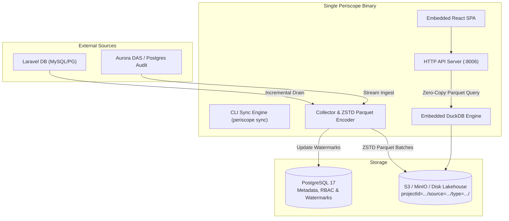

# Periscope

Periscope is a performant, enterprise-grade telemetry lakehouse and dashboard. It collects telemetry data (requests, logs, exceptions, queries) from remote Laravel applications and stores it as highly optimized Parquet files in an S3-compatible backend (like MinIO). The Go backend embeds DuckDB as an OLAP engine to query those Parquet files directly, while PostgreSQL is strictly used for RBAC, configuration, and watermarks.

## Architecture & Tech Stack

- **Backend:** Go 1.25+ (Single static binary)
- **Metadata Database:** PostgreSQL 17+ (Configuration, RBAC, Users, watermarks)
- **Lakehouse Storage:** Apache Parquet files with ZSTD compression in S3 / MinIO / Cloudflare R2 / Local Disk
- **OLAP Engine:** DuckDB (Embedded in Go)
- **Frontend:** React + Vite + Tailwind CSS (Embedded into the Go binary)

For full architectural specifications, sequence diagrams, and storage layouts, see [docs/architecture.md](docs/architecture.md).

## Single Binary Deployment

The UI is compiled via Vite and then completely embedded into the Go binary using `//go:embed`.
- All requests starting with `/api` are handled by the Go JSON router.
- All other requests serve the static React frontend.
This means the entire application runs natively on port `8006` with no separate UI container!

## Local Development Workflow

To get the best of both worlds (fast backend recompilation + fast frontend hot-reloading):
1. **Backend:** Run `docker-compose up -d --build`. This starts Postgres, MinIO, and uses `air` to hot-reload the Go binary on port `8006`.
2. **Frontend:** Run `pnpm dev` inside the `ui/` folder. This starts Vite on port `5173` with instant HMR. Vite proxies all `/api` requests to `8006`.

## Database Migrations

We use `pressly/goose` for robust database migrations. 
Migrations are stored in `internal/store/migrations/*.sql` and embedded directly into the CLI tool.

Available commands:
- `go run cmd/periscope/main.go migrate status`
- `go run cmd/periscope/main.go migrate up`
- `go run cmd/periscope/main.go migrate down`

## Admin Setup

To seed your first user:
`go run cmd/periscope/main.go make:user`
