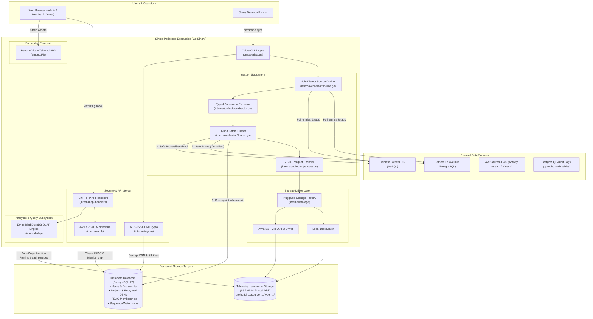
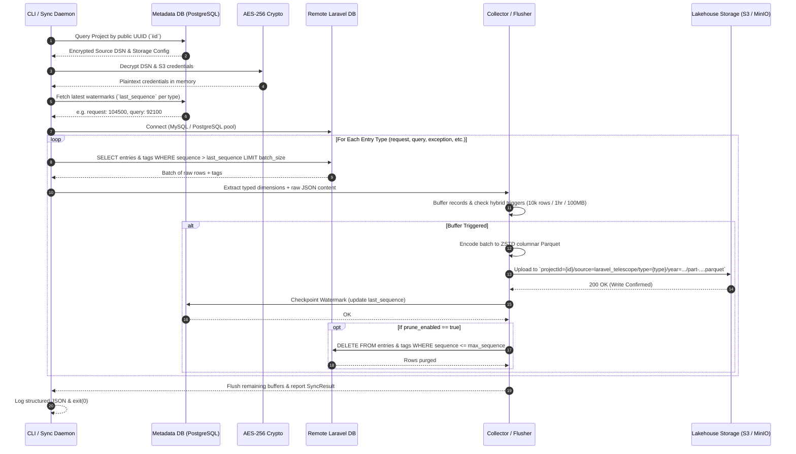
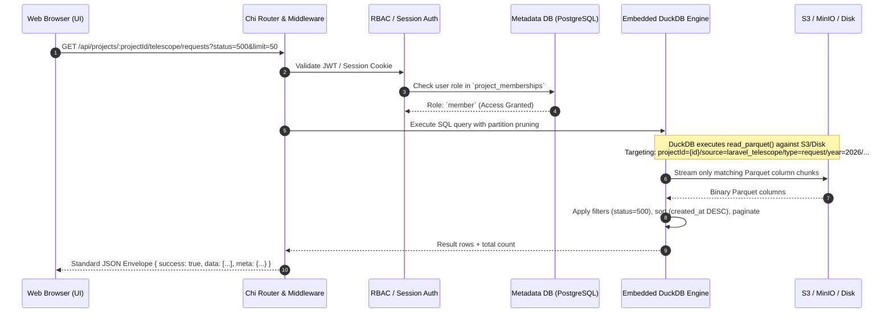

# Periscope Architecture & Application Flow

This document details the high-level system architecture, component relationships, data ingestion pipeline, and query flow for **Periscope**.

---

## 🏛️ 1. High-Level System Architecture



---

## 🔄 2. Ingestion & Draining Pipeline Flow (`periscope sync <project_iid>`)



---

## ⚡ 3. Analytics & Query Flow (Embedded DuckDB)



---

## 🗄️ 4. Lakehouse Storage Hierarchy (Hive Partitioning)

```text
periscope-bucket/
├── projectId=01912345-6789-7abc-def0-1234567890ab/
│   │
│   ├── source=laravel_telescope/
│   │   ├── type=request/
│   │   │   └── year=2026/month=08/day=29/hour=14/
│   │   │       └── part-000000000001-000000010000-a1b2c3d4.parquet
│   │   ├── type=query/
│   │   ├── type=exception/
│   │   └── type=log/
│   │
│   ├── source=aurora_das/
│   │   └── type=activity/
│   │       └── year=2026/month=08/day=29/hour=14/
│   │           └── part-000000000001-000000005000-f1e2d3c4.parquet
│   │
│   └── source=postgres_audit/
│       └── type=audit/
│           └── year=2026/month=08/day=29/hour=14/
│               └── part-000000000001-000000008000-7e8f9a0b.parquet
```

---

## 🧩 5. Component Responsibility Matrix

| Component | Directory | Responsibility |
| :--- | :--- | :--- |
| **CLI Framework** | `cmd/periscope/` | Entrypoint for all subcommands: `serve`, `sync`, `migrate`, `make:user`. |
| **Crypto Subsystem** | `internal/crypto/` | AES-256-GCM symmetric encryption for sensitive connection strings and secrets in PostgreSQL. |
| **Metadata Store** | `internal/store/` | PostgreSQL interactions via `pgx/v5`: User auth, Projects, RBAC memberships, and Watermark checkpoints. |
| **Auth & RBAC** | `internal/auth/` | Password hashing (bcrypt), JWT generation, HttpOnly session cookies, and project-scoped access guards (`admin`, `member`, `viewer`). |
| **Storage Drivers** | `internal/storage/` | Pluggable file storage abstraction: `LocalDriver` (atomic disk operations) and `S3Driver` (AWS S3, MinIO, Cloudflare R2). |
| **Collector & Drainer** | `internal/collector/` | Drains Laravel MySQL/Postgres DBs, extracts 16+ typed dimensions, encodes ZSTD Parquet, flushes hybrid batches, updates watermarks, and prunes source DB. |
| **OLAP Query Engine** | `internal/olap/` | Embedded DuckDB engine executing fast zero-copy SQL over S3/MinIO/Local Parquet files. |
| **API Server** | `internal/api/` | Chi router implementing standard `{ success, data, error, meta }` JSON envelopes. |
| **Frontend SPA** | `ui/` | React 18 + Vite + Tailwind CSS dashboard embedded into the Go executable via `embed.FS`. |
