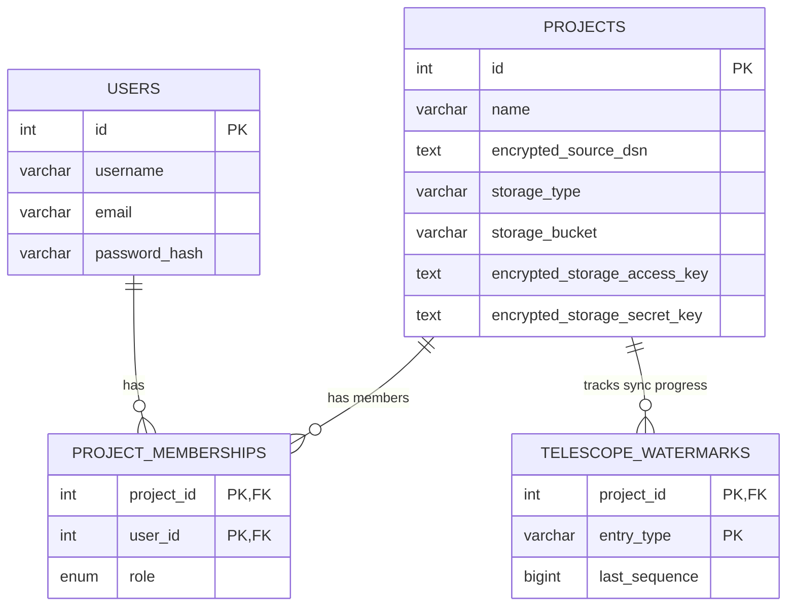

# Database Schema & Relations

This document explains the core PostgreSQL schema used by **Periscope**.

*Note: Parquet files act as the absolute single source of truth for the heavy telemetry data. The PostgreSQL database is used strictly for lightweight metadata, multi-tenant isolation, and configuration.*

## ER Diagram

## Tables Overview

### 1. `users`
**Purpose:** Stores global user accounts for the Periscope platform.
- **`id`**: Internal integer primary key (used strictly for foreign keys).
- **`iid`**: UUID (v7/v4) exposed to the frontend and API. Never expose `id`.
- Users authenticate against this table.
- A user alone does not have access to any telemetry data until they are granted a role in `project_memberships`.

### 2. `projects`
**Purpose:** Represents an isolated Laravel Application (tenant).
- **`id`**: Internal integer primary key (used strictly for foreign keys).
- **`iid`**: UUID (v7/v4) exposed to the frontend and API. Never expose `id`.
- Contains the crucial configuration required for the `periscope sync` worker to do its job.
- **`encrypted_source_dsn`**: The connection string to the actual operational Laravel database, encrypted via AES-GCM at rest.
- **`storage_*`**: Defines exactly where the exported Parquet files will be uploaded (e.g., MinIO or AWS S3), using encrypted access keys.

### 3. `project_memberships` (Join Table)
**Purpose:** Handles Role-Based Access Control (RBAC) and Multi-Tenancy.
- Links `users` to `projects`.
- **`role`**: An enum (`viewer`, `member`, `admin`).
  - `viewer`: Can only read UI telemetry.
  - `member`: Can run ad-hoc queries or manual syncs.
  - `admin`: Can modify the `projects` table credentials and manage other members.
- If a user tries to access `/projects/1/requests`, the API verifies a membership record exists for `project_id=1` and `user_id={current_user}`.

### 4. `telescope_watermarks`
**Purpose:** Tracks the incremental export progress for the `sync` background workers.
- **`entry_type`**: Maps to the Laravel Telescope type (e.g., `request`, `query`, `exception`).
- **`last_sequence`**: The highest `sequence` ID that was successfully batched and uploaded to S3 in Parquet format.
- When the `sync` CLI wakes up, it queries this table. For example, if `last_sequence` for `request` is `50000`, the worker will query the Laravel DB using `SELECT * FROM telescope_entries WHERE type='request' AND sequence > 50000`.

## 5. goose_db_version
**Purpose:** Automatically created and managed by `pressly/goose` to track applied migrations.
- Ensures migrations like `001_initial_schema.sql` are only applied once.
- DO NOT manually modify this table. Use the CLI commands (`periscope migrate up` / `periscope migrate down`).
